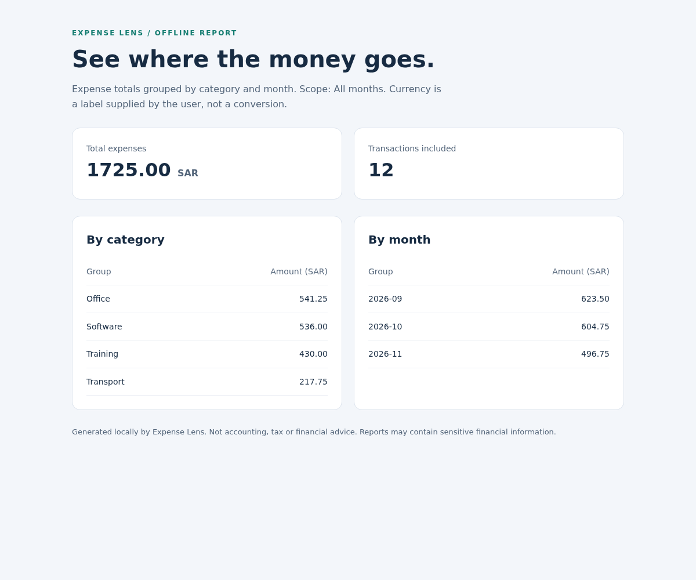

# Expense Lens

A small, dependency-free Python tool that turns an expense CSV into category and monthly totals, with an optional offline HTML report and JSON export.

**ملخص مصروفات بسيط:** أدخل ملف CSV، واحصل على إجمالي المصروفات حسب التصنيف والشهر، مع تقرير HTML يعمل بدون إنترنت.



## Why it is useful

Small businesses often collect expense rows in a spreadsheet but need a quick answer to two questions: which categories cost the most, and how spending changes each month. This tool does that one job locally, without uploading the CSV to a service.

## Quick start

Python 3.10+ is required. No packages, signup or API keys are needed.

```sh
python expense_lens.py sample_expenses.csv
mkdir reports
python expense_lens.py sample_expenses.csv --currency SAR --html reports/demo.html --json reports/demo.json
python expense_lens.py sample_expenses.csv --month 2026-11
python -m unittest -v
```

Open `reports/demo.html` in your browser. On Windows, `py` can be used instead of `python` if that is your Python launcher.

The sample contains **12 synthetic expenses**, totaling **1725.00 SAR**. It contains no real financial or customer data. November alone totals **496.75 SAR**.

## Input format

UTF-8 CSV, optionally with a BOM. Required headers are exactly `date,category,amount`. Extra columns such as `description` are allowed but ignored. Categories are case-sensitive and trimmed; `Office` and `office` are different groups.

```csv
date,category,amount
2026-11-02,Software,149.00
2026-11-04,Transport,72.25
```

- Dates must be real calendar dates in `YYYY-MM-DD` format.
- Amounts must be non-negative plain decimal numbers with at most two decimal places. No thousands separators, currency symbols, scientific notation, negative refunds, or mixed decimal conventions.
- All rows must be in **one currency**. `--currency` is only a three-letter uppercase display label, not currency detection, validation or exchange-rate conversion. The default is SAR. Currencies needing more than two decimal places are not supported.
- Malformed rows fail the whole input with a line number instead of silently changing totals. A header-only file is rejected. A valid month with no matches produces zero totals.
- Decimal arithmetic is used for money. Rows above `999999999999.99` are rejected.
- Output paths must be new and their parent directories must exist. The tool never intentionally overwrites an existing file. If a write fails partway through, remove the incomplete new report before retrying.

## Example output

```text
Expense Lens | 12 transactions | 1725.00 SAR

By category:
  Office: 541.25 SAR
  Software: 536.00 SAR
  Training: 430.00 SAR
  Transport: 217.75 SAR
```

See the sample data for all monthly values. JSON stores monetary totals as strings so downstream software does not accidentally convert them to binary floats.

## Privacy and limits

This is a local command-line utility, not a bookkeeping system. It does not import bank accounts, categorize expenses automatically, detect duplicates, reconcile payments, calculate VAT, validate tax invoices, or establish ZATCA compliance. It does not use an AI model.

The input is read into memory, so this is intended for modest CSV files, not very large datasets. Reports and terminal output may contain sensitive category names and totals. Keep real data and generated reports out of GitHub. `private-data/` and `reports/` are ignored as a convenience, not a security boundary. Raw expense rows and descriptions are not included in exported reports.

## Tests

The standard-library test suite covers exact totals, month filters, decimal precision, Arabic categories, invalid dates and amounts, malformed CSV, safe HTML escaping, and command-line output/error behavior.

## Possible next steps

Optional future work, not implemented: expense charts, a currency column with mixed-currency rejection, and a user-selected category mapping file.
